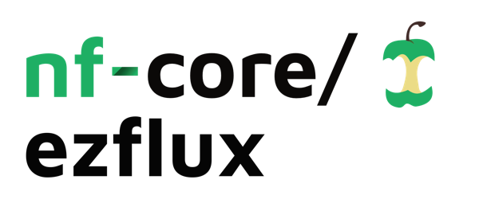

<h1>
  <picture>
    <source media="(prefers-color-scheme: dark)" srcset="docs/images/nf-core-ezflux_logo_dark.png">
    
  </picture>
</h1>


[](https://github.com/codespaces/new/nf-core/ezflux)
[](https://github.com/nf-core/ezflux/actions/workflows/nf-test.yml)
[](https://github.com/nf-core/ezflux/actions/workflows/linting.yml)[](https://nf-co.re/ezflux/results)[](https://doi.org/10.5281/zenodo.XXXXXXX)
[](https://www.nf-test.com)

[](https://www.nextflow.io/)
[](https://github.com/nf-core/tools/releases/tag/4.2.1)
[](https://docs.conda.io/en/latest/)
[](https://www.docker.com/)
[](https://sylabs.io/docs/)
[](https://cloud.seqera.io/launch?pipeline=https://github.com/nf-core/ezflux)

[](https://nfcore.slack.com/channels/ezflux)[](https://bsky.app/profile/nf-co.re)[](https://mstdn.science/@nf_core)[](https://www.youtube.com/c/nf-core)

## Introduction

**nf-core/ezflux** is a bioinformatics pipeline that predicts which metabolites the members of a microbial community take up and secrete on a given diet. It takes metagenomic reads or ASV tables, builds [MICOM](https://micom-dev.github.io/micom/) community metabolic models from them, simulates growth on one or more diets and writes merged exchange tables, production/consumption rates and niche plots.

1. **Preprocessing**
   - Reads: runs of the same sample are concatenated (`cat/fastq`), profiled with [`sylph`](https://github.com/bluenote-1577/sylph) and re-annotated with the model metadata (R)
   - Wide ASV table (`--seqtab_input`): ASVs are extracted to FASTA, searched once against a 16S database with [`blastn`](https://blast.ncbi.nlm.nih.gov/), the best hits are formatted (R) and mapped to species per sample with the model metadata
   - Match the species to the models of the MICOM database (`MICOM_TAXONOMY`)
2. **Growth**: build each community and simulate growth for every sample and diet ([`MICOM`](https://micom-dev.github.io/micom/), cooperative trade-off FBA)
3. **Merging**: combine all results, export exchanges and rates, plot import/export niches, growth rates and how much of each community was found in the model database (static versions of the plots are in the MultiQC report)
4. Software versions and run summary ([`MultiQC`](http://multiqc.info/))

## Usage

> [!NOTE]
> If you are new to Nextflow and nf-core, please refer to [this page](https://nf-co.re/docs/get_started/environment_setup/overview) on how to set-up Nextflow. Make sure to [test your setup](https://nf-co.re/docs/get_started/run-your-first-pipeline) with `-profile test` before running the workflow on actual data.

First, prepare a samplesheet with your samples:

`samplesheet.csv`:

```csv
sample,run_accession,fastq_1,fastq_2
2612,ERR5766176,/data/2612_run1_1.fastq.gz,/data/2612_run1_2.fastq.gz
2612,ERR5766176_B,/data/2612_run2_1.fastq.gz,/data/2612_run2_2.fastq.gz
```

`sample` can be a name or a number. Rows with the same `sample` and different `run_accession` are concatenated before profiling. `fastq_2` is empty for single-end data.

Instead of reads you can give a **wide ASV sequence table** with `--seqtab_input` (sample ids in the first column, ASV sequences as the other columns, counts as values). The sample ids are read from the table; use `--input` or `--seqtab_input`, not both.

To combine growth results of earlier runs, give a samplesheet of `sample,growth_zip,build_manifest` with `--growth_input` instead: all analysis steps are skipped and only the merge and MultiQC steps run (see [usage](docs/usage.md#merging-results-of-earlier-runs---growth_input)).

Optionally, a media sheet with the diets to simulate (without it every sample grows on `--medium`, by default the western diet from Zenodo):

`media.csv`:

```csv
medium_name,medium_path,sample_id
western_diet,/data/western_diet_gut_agora.qza,
high_fiber,/data/high_fiber_gut_agora.qza,GUT_ASV
```

A row without `sample_id` applies to all samples; a row with one applies to that sample only. Every sample needs at least one diet.

Now, you can run the pipeline using:


```bash
nextflow run nf-core/ezflux \
   -profile <docker/singularity/.../institute> \
   --input samplesheet.csv \
   --media media.csv \
   --micom_db agora201_refseq216_species_1.qza \
   --model_metadata agora2.metadata.csv \
   --sylph_db agora2.syldb \          # samples with reads
   --blast_db /db/16S_blast \         # only with --seqtab_input
   --outdir <OUTDIR>
```

`-profile test` runs the nf-core/funcprofiler test samplesheet (integer sample IDs, two runs per sample) and expects `agora2.syldb`, `agora2.metadata.csv` and `agora201_refseq216_species_1.qza` in the launch directory. To check your set-up with the tiny bundled dataset (ASV tables, no license or downloads needed, run from the pipeline directory):

```bash
nextflow run . -profile test_local,<docker/singularity/.../conda> --outdir test_results
```

> [!WARNING]
> Please provide pipeline parameters via the CLI or Nextflow `-params-file` option. Custom config files including those provided by the `-c` Nextflow option can be used to provide any configuration _**except for parameters**_; see [docs](https://nf-co.re/docs/running/run-pipelines#using-parameter-files).

For more details and further functionality, please refer to the [usage documentation](https://nf-co.re/ezflux/usage) and the [parameter documentation](https://nf-co.re/ezflux/parameters).

## Pipeline output

To see the results of an example test run with a full size dataset refer to the [results](https://nf-co.re/ezflux/results) tab on the nf-core website pipeline page.
For more details about the output files and reports, please refer to the
[output documentation](https://nf-co.re/ezflux/output).

## Credits

nf-core/ezflux was originally written by Nick Waters

We thank the following people for their extensive assistance in the development of this pipeline:

<!-- TODO nf-core: If applicable, make list of people who have also contributed -->

## Contributions and Support

If you would like to contribute to this pipeline, please see the [contributing guidelines](docs/CONTRIBUTING.md).

For further information or help, don't hesitate to get in touch on the [Slack `#ezflux` channel](https://nfcore.slack.com/channels/ezflux) (you can join with [this invite](https://nf-co.re/join/slack)).

## Citations

<!-- TODO nf-core: Add citation for pipeline after first release. Uncomment lines below and update Zenodo doi and badge at the top of this file. -->
<!-- If you use nf-core/ezflux for your analysis, please cite it using the following doi: [10.5281/zenodo.XXXXXX](https://doi.org/10.5281/zenodo.XXXXXX) -->

An extensive list of references for the tools used by the pipeline can be found in the [`CITATIONS.md`](CITATIONS.md) file.

You can cite the `nf-core` publication as follows:

> **The nf-core framework for community-curated bioinformatics pipelines.**
>
> Philip Ewels, Alexander Peltzer, Sven Fillinger, Harshil Patel, Johannes Alneberg, Andreas Wilm, Maxime Ulysse Garcia, Paolo Di Tommaso & Sven Nahnsen.
>
> _Nat Biotechnol._ 2020 Feb 13. doi: [10.1038/s41587-020-0439-x](https://dx.doi.org/10.1038/s41587-020-0439-x).
